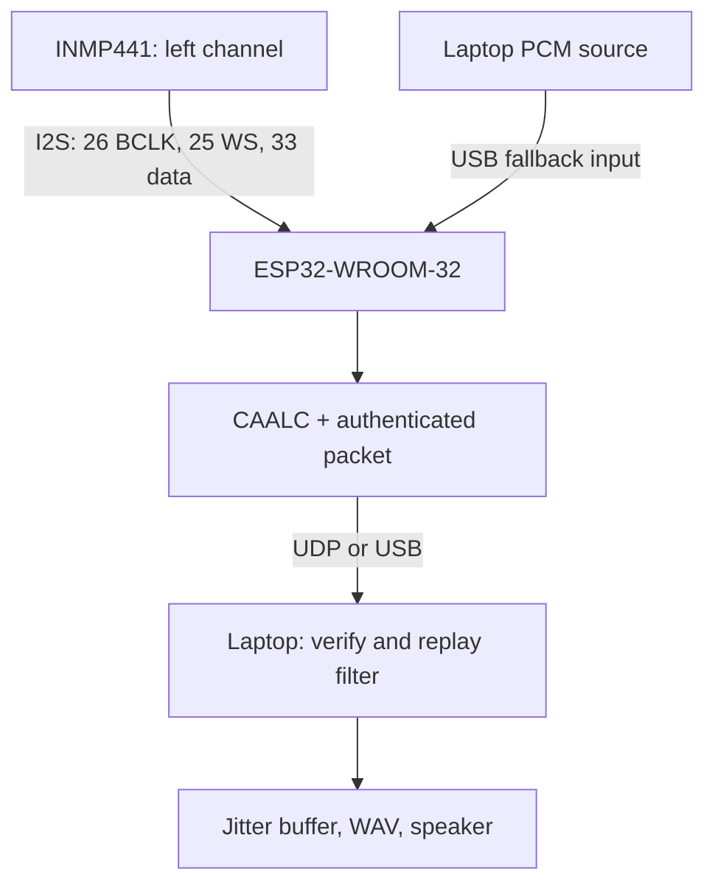

# One-ESP32 hardware demonstration

## Budget gate

₹500 is a **hard purchasing ceiling**, not a tested current shopping basket. Check your local total including shipping/tax before ordering. Suggested allocation caps, not price quotations:

| Item | Maximum allocation | Required? |
|---|---:|---|
| ESP32-WROOM-32 DevKit V1, compatible USB interface | ₹350 | Yes, for physical demo |
| INMP441 microphone + necessary connecting wires | remaining ₹150 | Optional |
| Laptop, USB data cable, Wi-Fi, headphones | existing | Already owned |

If the microphone/wires would push the total above ₹500, omit them and demonstrate laptop PCM → USB → ESP32 encryption → USB → laptop verification/playback. Do not buy an Uno, second ESP32, SD card, DAC/amplifier or speaker. A USB **data** cable is needed; a charge-only cable will not work. The software-only demonstration costs no new hardware.

## INMP441 wiring

Disconnect power before wiring. Use 3.3 V logic/power, never 5 V on the microphone.

| INMP441 | ESP32 DevKit V1 |
|---|---|
| VDD / VCC | 3V3 |
| GND | GND |
| SCK / BCLK | GPIO26 |
| WS / LRCL | GPIO25 |
| SD / DOUT | GPIO33 |
| L/R | GND (left channel) |



INMP441 normally supplies 24 significant bits in 32-bit I2S slots. The firmware takes the upper 16 bits (`sample >> 16`) for signed PCM16. Check recorded level and clipping on your particular module; this conversion has not been acoustically calibrated. Firmware uses 8 kHz, 160 samples, 20 ms/frame. No floating-point operation is used in the cipher loop.

## Arduino IDE installation and flashing

1. Install Arduino IDE 2.x. In Settings/Preferences → Additional Boards Manager URLs add:
   `https://espressif.github.io/arduino-esp32/package_esp32_index.json`
2. Boards Manager → **esp32 by Espressif Systems**, choose **2.0.17**. The sketch intentionally targets its legacy `driver/i2s.h` API; do not silently use an incompatible future core.
3. Run `python prepare_arduino.py` from the project folder. Open `build/esp32_caalc/esp32_caalc.ino`. This copies the shared headers and satisfies Arduino's folder naming rule.
4. Select **ESP32 Dev Module** (classic ESP32/WROOM-32), appropriate COM port, default 4 MB flash and default partition. Use upload speed 115200 if a higher speed is unreliable.
5. Verify/compile, then upload. If auto-boot fails, hold BOOT when the uploader says Connecting, then release. Install the board's CP210x or CH340 USB driver if the port does not appear.
6. Serial Monitor speed is **921600 baud**; newline ending. At boot you should see a request for trusted USB configuration. Close Serial Monitor before running the Python serial script (only one process may own the port).

No third-party Arduino library is required for the sender: WiFi, WiFiUDP and I2S are part of the pinned ESP32 core. All crypto buffers are fixed-size; SDK Wi-Fi/I2S libraries may allocate during setup. The firmware does not claim a zero-allocation networking stack.

Equivalent CLI commands if `arduino-cli` is installed:

```bash
arduino-cli core update-index --additional-urls https://espressif.github.io/arduino-esp32/package_esp32_index.json
arduino-cli core install esp32:esp32@2.0.17 --additional-urls https://espressif.github.io/arduino-esp32/package_esp32_index.json
python prepare_arduino.py
arduino-cli compile --fqbn esp32:esp32:esp32 build/esp32_caalc
arduino-cli upload -p COM5 --fqbn esp32:esp32:esp32 build/esp32_caalc
```

## USB-only acceptance test

1. Run `python main.py demo` to generate a known 8 kHz WAV.
2. Flash the sender. Close Serial Monitor.
3. Run `python hardware_session.py --serial COM5 --mode USB --wav results/original.wav --seconds 4 --out results/usb_received.wav`.
4. Read `results/usb_received.wav.json`: accepted packets should match sent frames, with no authentication rejection. The receiver's capture window may append concealment silence after the source ends; compare only the original sample-length prefix, not this intentionally extended window.
5. Compare with this exact command (after changing neither filename):

```bash
python verify_hardware_audio.py results/original.wav results/usb_received.wav
```

It verifies the complete original PCM prefix and reports appended silence separately. Missing/late frames in the original portion fail exact comparison. Playback is optional: `python main.py play results/usb_received.wav`.

## Microphone / UDP acceptance test

1. Wire the microphone as above. Connect the laptop and ESP32 to the same **2.4 GHz** network. Client isolation/guest Wi-Fi may block peer UDP.
2. Find the laptop's local IPv4 address using `ipconfig` (Windows), `ip addr` (Linux) or network settings (macOS).
3. Allow inbound UDP port 5005 on the private network in the laptop firewall.
4. Run the MIC command in README with the actual SSID and laptop IP. The compact config parser does not support whitespace in SSID/password; use a temporary controlled hotspot with simple credentials if needed.
5. Speak/clap for the capture period. Inspect the WAV, packet counts, jitter and authentication results. There must be **no** release of a modified packet. Test tampering with the supplied software tests; do not infer successful authentication just from audible noise.
6. Record board model, core/compiler versions, CPU frequency, firmware flash and RAM report, frame timing, packet loss, latency, ambient conditions and Wi-Fi signal. Hardware is accepted only after flashing, verified traffic and actual audio have been observed.

## Timing and memory

Sender emits `STAT frames=... enc_mean_us=... enc_max_us=... heap=...` every 100 frames. Encryption measurement covers AEAD only, excluding I2S and transport. The USB receiver ignores diagnostic lines; use a serial monitor or instrument a capture to save them after the primary test. Free heap is whole-firmware heap availability, not isolated cipher RAM or energy usage.

For the fair same-board benchmark:

```bash
python prepare_hardware_benchmark.py
arduino-cli compile --fqbn esp32:esp32:esp32 build/esp32_benchmark
arduino-cli upload -p COM5 --fqbn esp32:esp32:esp32 build/esp32_benchmark
```

Open Serial Monitor at **115200**. It runs both portable cores at 160, 320, 640 and 1280 bytes, 5 warmups + 200 measured repetitions each, checks decryption, and prints CSV. Save the output as `results/esp32_benchmark.csv`. Use identical board/core/settings. The default payload is zero PCM to isolate payload-length timing; for real recorded audio use the sender capture separately. An ESP32 compiler result is not physical execution evidence. The packaged verification status states precisely what was attempted here.

## Provisioning and security boundary

`hardware_session.py` generates a fresh key and random session ID automatically on each run. Optional `--key results/session.key` uses the fresh ML-KEM demo key. Do not reuse that key/session after reset. The firmware accepts configuration once per boot, requires no hardcoded credentials, and emits no key. Key memory is not guaranteed to be securely erased by the compiler or SDK. USB is trusted for this demonstration; an attacker with physical USB access can reprogram/provision the device.

ML-KEM runs between two logical endpoints in one laptop process. Provisioning the resulting traffic key to ESP32 demonstrates integration, **not a complete authenticated end-to-end PQ protocol**. Remote endpoint authentication, identity binding, anti-rollback, key confirmation and protected persistent storage remain future work.
