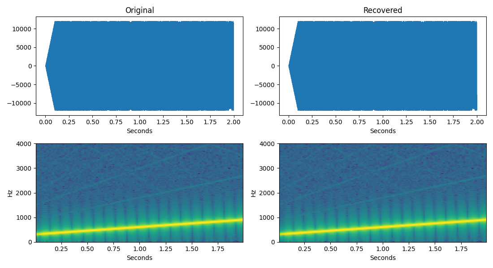
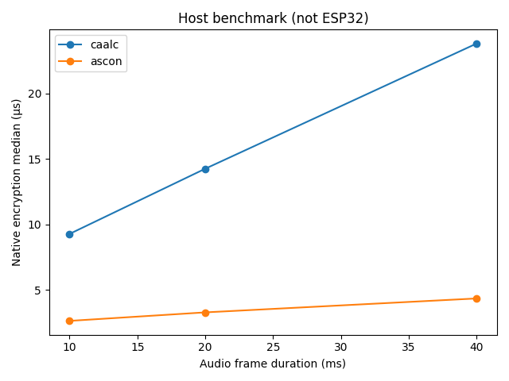

# Measured host results

Platform: Linux-6.18.55-x86_64-with-glibc2.39. See `environment.json` for versions.

Both portable native implementations, -O2, same ctypes wrapper, cycle same WAV frames; timings include FFI, 5 warmups. Not ESP32 measurements.

## Audio reconstruction

MSE = 0.0; PSNR = inf; SNR = inf; exact sample fraction = 1.0. Source: two-second synthetic 8 kHz mono chirp, not a microphone recording.

## Native implementation benchmark

| Cipher | Frame ms | Payload B | Encrypt median µs | Decrypt median µs | Encrypt p95 µs | MiB/s |
|---|---:|---:|---:|---:|---:|---:|
| caalc | 10 | 160 | 9.267 | 9.277 | 88.543 | 16.47 |
| ascon | 10 | 160 | 2.621 | 2.643 | 6.281 | 58.22 |
| caalc | 20 | 320 | 14.248 | 14.189 | 106.523 | 21.42 |
| ascon | 20 | 320 | 3.271 | 3.233 | 18.330 | 93.30 |
| caalc | 40 | 640 | 23.813 | 23.828 | 109.540 | 25.63 |
| ascon | 40 | 640 | 4.335 | 4.316 | 10.016 | 140.81 |

200 measured trials per row, 5 warmups. Both ciphers cycle through the same WAV frames. Timing includes ctypes overhead. Raw timings are in benchmark_raw.json; scheduling/outliers are not concealed. Ascon was faster in these host measurements. These are not ESP32, energy or production-performance claims. Packet overhead is 44 bytes for both algorithms, excluding transport headers.

## Screening statistics

- State avalanche mean: 49.565%; sampled range 44.010–55.208% over 128 trials.
- Key sensitivity mean: 50.063%.
- Empirical ciphertext byte entropy over 65,536 bytes: 7.997022 bits/byte.
- Exact rotation equivalence: 0/32 sampled pairs.
- Distinct output words for five repeated-word states: [12, 12, 12, 12, 12].

| Rounds | Mean changed output bits (%) |
|---:|---:|
| 1 | 0.806 |
| 2 | 1.953 |
| 4 | 8.968 |
| 8 | 40.932 |
| 12 | 50.470 |
| 24 | 49.565 |

No duplicate sampled output differences were found in this run. That observation is not a differential attack bound. Simple screens did not expose a functional defect requiring a change to the supplied round function. The raw F has rotation/cyclic-word symmetry; constants break tested exact symmetries but unexamined weaknesses remain. No security conclusion follows from the scores.

## Simulated network loss

Seed 123: 91/100 frames received; 9 replaced by silence; 0 late. Requested loss probability 0.1, maximum injected jitter 15 ms.
Recovery PSNR with loss: 23.229 dB; SNR 11.345 dB. This is simulation, not measured Wi-Fi loss.

## Code and memory evidence

The compiler `size` output in native_object_size.txt reports 3,585 bytes for the CAALC object and 13,782 for upstream reference Ascon on this host build. GNU text size includes code/read-only sections; it is not total ESP32 flash. CAALC includes an inverse-permutation API not used in live audio. These figures depend on source variant, architecture, inlining and compiler.

The .su files contain compiler per-function stack estimates, not whole-call-chain peak RAM. CAALC state is 48 bytes plus temporaries; Ascon state is 40 bytes plus temporaries. Neither implementation allocates a heap buffer in its core API; caller input/output buffers and Python/FFI/SDK memory are separate. No physical ESP32 RAM, flash, execution, latency or power measurement is claimed.

## Large custom-cipher audio test

A 1,048,576-byte PCM recording (65.536 seconds at 8 kHz) passed exact CAALC file reconstruction with 40 ms frames. Python reference encryption took 40.930 s and decryption 22.519 s on this shared host. This is separate from the native benchmark and includes file/container work.
